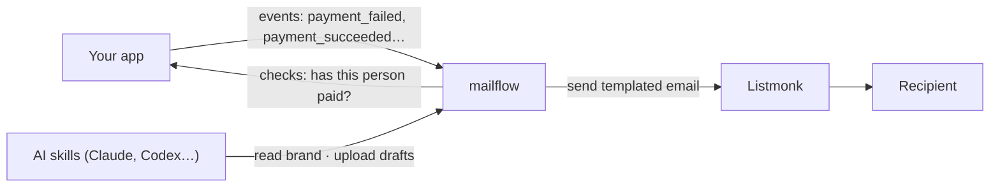

# mailflow

Self-hosted email workflows for your own app. Draw a flow, write on-brand emails with AI, and let [Listmonk](https://listmonk.app) deliver them.

> **Status: early.** The failed-payment workflow runs end to end: events in, emails out through Listmonk, checks back to your app, and an admin UI. Editing workflow steps in the UI is not built yet.

## What it does

- **Workflows on a canvas.** "Payment failed → send email → wait 3 days → has it been paid? → no → send reminder." Your app sends events; mailflow decides who gets which email and when.
- **Stop conditions.** A run ends as soon as your app reports the outcome you were waiting for, such as the payment succeeding.
- **One brand profile.** Colours, fonts, button shape, footer and tone of voice live in one `brand.json`, edited in the admin UI. Every template renders from it, so changing the brand changes every email.
- **AI-written emails that stay on brand.** The skills in [`skills/`](skills/) write emails as blocks (heading, text, button…), and mailflow renders them to email-safe HTML with [MJML](https://mjml.io). Pasted HTML is still accepted but has to pass a brand check before it can be published.
- **Listmonk delivers.** mailflow never talks SMTP itself.

## Why

Hosted email automation is priced per contact, which gets expensive fast once you run it for several apps. mailflow is meant to be deployed once per app, owned by that app, at the cost of a small server.

## How it fits



Your app stays the owner of its users and its data. mailflow owns templates, workflows, timers and the history of every run. See [docs/architecture.md](docs/architecture.md).

## Run it locally

```sh
pnpm install
docker compose -f dev/compose.yml up -d      # Postgres, Listmonk, Mailpit
cp .env.example .env                         # fill in MAILFLOW_SECRET and LISTMONK_API_TOKEN
docker compose -f dev/compose.yml logs listmonk | grep LISTMONK_ADMIN_API_TOKEN
pnpm db:migrate && pnpm dev
```

Listmonk prints its API token once, on first install. Sent mail lands in Mailpit at http://127.0.0.1:58025.

## Deploy

Build the image from the `Dockerfile` and run it with the variables in `.env.example`. On start it applies migrations, then serves the app and runs the worker. A fresh database gets the example failed-payment workflow and templates as a **draft**, so nothing is sent until an admin sets the workflow to Live. You also need a Listmonk (v6.2 or later) with working SMTP, and an API user for mailflow.

## Connect your app

Your app and mailflow share `MAILFLOW_SECRET`. Every request carries `X-Mailflow-Signature: t=<unix seconds>,v1=<hex HMAC-SHA256 of "<purpose>.<t>.<body>">` and is rejected after five minutes.

- **Events in.** `POST /api/events`, purpose `event`, with `{ id, type, recipient: { id, email }, data, occurredAt }`. The `id` makes retries safe.
- **Checks out.** mailflow sends `POST <HOST_URL>/checks`, purpose `check`, with `{ check, recipientId, runId, data }`. Your app answers `{ "result": true | false }`.
- **Admin sign-in.** Your app sends an admin to `/sso?token=<base64url(json {email, name, exp}).base64url(HMAC-SHA256 of "sso.<payload>")>`. Keep `exp` within a minute.

The reference implementation of each part is in [`src/domain/signing.ts`](src/domain/signing.ts).

## Develop

- `pnpm test` runs the tests against the dev Postgres, in a separate `test` schema.
- `pnpm e2e` drives three people through the failed-payment workflow, with real Listmonk delivery into Mailpit and a simulated clock.
- `scripts/mutate.sh` breaks six core rules one at a time and expects the tests to catch each one.
- [`docs/decisions.tsv`](docs/decisions.tsv) logs why things are built the way they are.

## Roadmap

1. ~~**Thin slice:** the failed-payment workflow, event intake, timers, Listmonk delivery, run history.~~ Done.
2. ~~**Brand + templates:** `brand.json`, MJML block renderer, pasted HTML with brand check, preview, test send, versioned publishing.~~ Done.
3. **Canvas editor:** build and edit workflow steps in the canvas. Today the canvas is read-only and steps change through the database.
4. **Packaging:** published versioned images and deploy recipes.

## Licence

[MIT](LICENSE)
