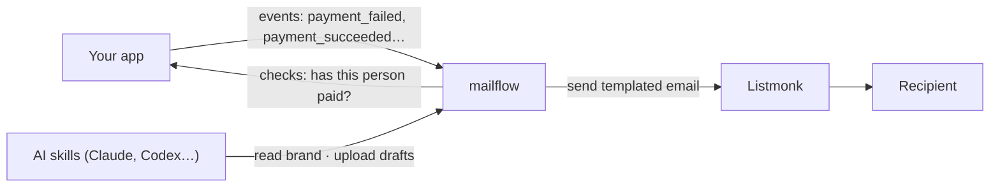

# mailflow

Self-hosted email workflows for your own app. Draw a flow, write on-brand emails with AI, and let [Listmonk](https://listmonk.app) deliver them.

> **Status: pre-alpha.** Nothing here runs yet. This repo holds the design, the brand profile format and the AI skills while the first version is being built.

## What it does

- **Workflows on a canvas.** "Payment failed → send email → wait 3 days → has it been paid? → no → send reminder." Your app sends events; mailflow decides who gets which email and when.
- **Stop conditions.** A run ends as soon as your app reports the outcome you were waiting for, such as the payment succeeding.
- **One brand profile.** Colours, fonts, button shape, footer and tone of voice live in one `brand.json`, edited in the admin UI. Every template renders from it, so changing the brand changes every email.
- **AI-written emails that stay on brand.** The skills in [`skills/`](skills/) write emails as blocks (heading, text, button…), and mailflow renders them to email-safe HTML with [MJML](https://mjml.io). Pasted HTML is still accepted but has to pass a brand check before it can be published.
- **Listmonk delivers.** mailflow never talks SMTP itself.

## Why

Hosted email automation is priced per contact, which gets expensive fast once you run it for several apps. mailflow is meant to be deployed once per app, owned by that app, at the cost of a small server.

## How it fits

Your app stays the owner of its users and its data. mailflow owns templates, workflows, timers and the history of every run. See [docs/architecture.md](docs/architecture.md).

## Roadmap

1. **Thin slice:** one hard-coded workflow (payment failed → email → wait → check → reminder), event intake, timers, Listmonk delivery, run history.
2. **Brand + templates:** `brand.json`, block renderer (MJML), pasted HTML with brand check, preview and test send, versioned publishing.
3. **Canvas editor:** build and edit workflows visually.
4. **Packaging:** versioned Docker images, one-click deploy recipes.

## Licence

[MIT](LICENSE)
